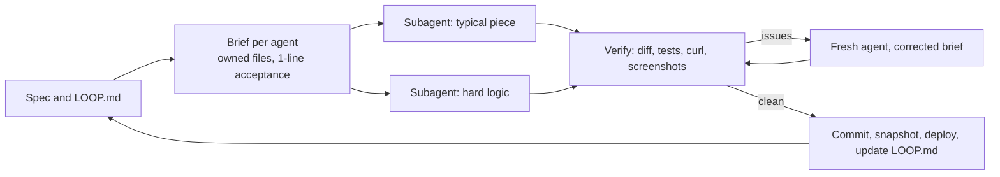

# claude-skills

Claude Code skills, hooks and multi-agent workflow scripts for running Claude Code as an orchestrator of subagents.

The package shows how I work with Claude Code on long projects: the main session plans, briefs and accepts, and subagents write the code. It is for engineers who run Claude Code on multi-day work and want a tested structure for loops, agent briefs, acceptance and generative media pipelines.



## What is inside

| Part | Files | What it is |
|---|---|---|
| `skills/ai-visual` | 6 docs, 600 lines | Creative direction for photoreal AI stills and video on Higgsfield: a 6-slot lighting formula, anti-plastic doctrine, model routing with measured credit costs per second for 11 video models, continuity through canonical reference frames, a client workflow with sign-off gates. |
| `skills/palmier-edit` | 2 docs | Timeline assembly through the Palmier MCP server: frame math, cadence grid, dissolves, ID handling rules. |
| `skills/ai-visual-start` | 1 doc | Session start for the visual workflow: load skills, start the storyboard tool, a 4-question intake, then branch into new campaign, client order or continue. |
| `skills/orchestrator-loop` | 1 doc | The loop: contract, briefs by file ownership, acceptance by diff + tests + curl, stop conditions. |
| `skills/public-snapshot` | 1 doc | Turning private work into a public repo without history, with a leak hunt before push. |
| `harness/WORKING-RULES.md` | 33 rules | Working rules distilled from real failures, each with a one-line reason. |
| `harness/LOOP-TEMPLATE.md` | template | `LOOP.md` for a multi-stage build: rules, roles by model, iteration steps, stage table, owner checklists, journal. |
| `harness/AGENT-BRIEF-TEMPLATE.md` | template | A subagent brief with owned files, acceptance line, verify commands and report format. |
| `harness/notes/figma-mcp-gotchas.md` | notes | Figma MCP mechanics: limits, geometry, text sizing traps, reliability. |
| `hooks/` | 2 scripts, 1 config | A sticky `UserPromptSubmit` reminder hook and a status line. |
| `workflows/` | 5 scripts, 361 lines | Workflow tool scripts: read-only triage, fix/verify/fix, judge panel, critic/fix loop, adversarial leak hunt. See `workflows/README.md`. |

The skills in `skills/ai-visual`, `skills/palmier-edit` and `skills/ai-visual-start` are working artifacts in Russian. Everything else is in English.

## Key decisions

- **The main model does not write feature code.** It writes contracts and briefs, and accepts. In one project a 2,500-line engine written by the main session alone took longer than the same scope split across agents.
- **Parallel agents split by file ownership, not by topic.** Each brief names the files the agent owns and says another agent edits the rest.
- **Acceptance is by evidence.** Diff read, tests run, endpoints curled, screenshots opened. An agent's "all good" does not count. A failed piece goes to a fresh agent with the fix in the brief.
- **One unit, then scale.** Feedback is applied to 1 item, confirmed, then rolled out in batches of 5 to 7 with a check after each batch. This rule came from a rollback of edits across 28 finished items.
- **Critic loops are bounded and report leftovers.** Minor issues are dropped after round 1, the loop stops after 2 rounds, and the script returns what remains.
- **Judges use lenses.** Three judges score two independent builds on audience, design language and craft; scores are summed in code.
- **Hooks are reinforcement, not enforcement.** The reminder hook uses a visible canary (two capital letters at the start of each reply) to show when the harness context has dropped out.
- **Video: cheap draft first.** A 5 s motion draft on a small model costs 5 credits; the final model costs 22.5. Prompts are shown in full before any expensive run, and clips run one at a time.

## Structure

```
skills/
  ai-visual/            SKILL.md + 01 prompt craft, 02 model routing, 03 pipeline, 04 client workflow, 05 prompt formulas
  ai-visual-start/      SKILL.md (session start command)
  palmier-edit/         SKILL.md + 01 assembly patterns
  orchestrator-loop/    SKILL.md
  public-snapshot/      SKILL.md
harness/
  WORKING-RULES.md
  LOOP-TEMPLATE.md
  AGENT-BRIEF-TEMPLATE.md
  notes/figma-mcp-gotchas.md
hooks/
  harness-reminder.sh   UserPromptSubmit hook
  statusline.sh         folder, model, context percent
  settings.example.json
workflows/
  README.md             patterns explained
  triage-read-only.js
  fix-verify-fix.js
  judge-panel.js
  critic-fix-loop.js
  public-snapshot-leak-hunt.js
tools/
  check.sh              validates every file in the package
```

## Use

Install the skills for your user:

```sh
git clone <this repo> claude-skills
mkdir -p ~/.claude/skills
cp -R claude-skills/skills/* ~/.claude/skills/
```

Install the hooks, then merge `hooks/settings.example.json` into `~/.claude/settings.json` (both need `jq`):

```sh
mkdir -p ~/.claude/hooks
cp claude-skills/hooks/*.sh ~/.claude/hooks/
```

Test the hook without Claude Code:

```sh
echo '{"session_id":"t","prompt":"seedance prompt","cwd":"/tmp"}' | bash claude-skills/hooks/harness-reminder.sh
```

Set `HARNESS_KEYWORDS` and `HARNESS_TEXT` in the environment to reuse the hook for another rule set.

Start a loop in a project: copy `harness/LOOP-TEMPLATE.md` to `LOOP.md` in the project root, fill RULES and the stage table, then ask Claude Code to "open LOOP.md and continue the loop".

Run a workflow example: pass the file content to the Workflow tool as `script` with `args` for the placeholders (see the comment block at the top of each script).

Validate the package:

```sh
bash tools/check.sh
```

## Status

- The skills and rules are in daily use. The `ai-visual` skill references a storyboard tool (`tools/storyboard`) and project files (`RUN.md`, `storyboard.json`) that live in the project repo, not here; paths are placeholders such as `<ai-visual-root>`.
- The workflow scripts are generalized examples. The originals ran on real projects; these versions have not been re-run after generalization.
- Credit costs in `skills/ai-visual/02_higgsfield-routing.md` were measured in August and September 2026 and change with the vendor's pricing.
- Third-party skills I use (Higgsfield CLI skills, a Seedance prompt pack, sales and trading skill packs, frontend-design) are not included.

## License

MIT. See `LICENSE`.
